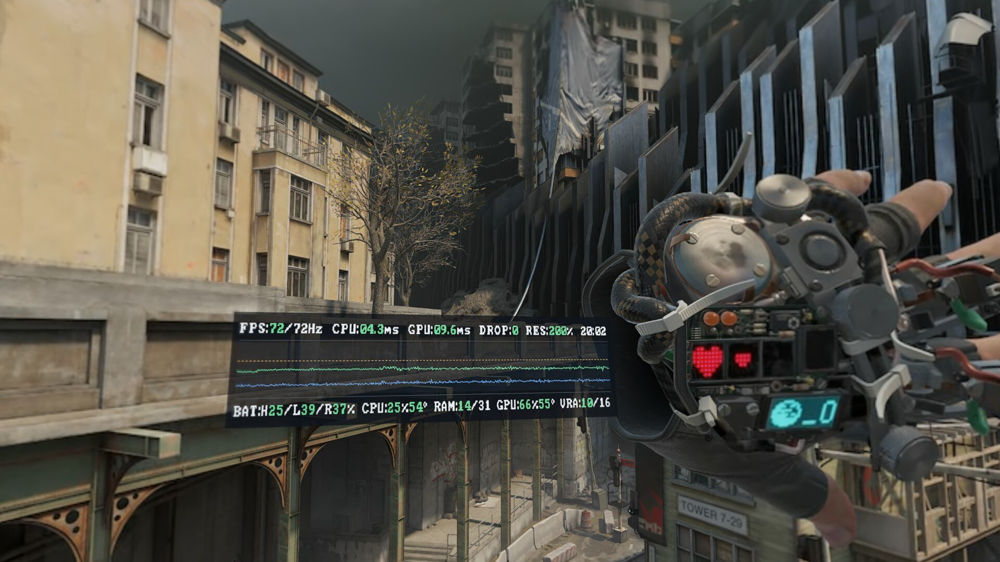
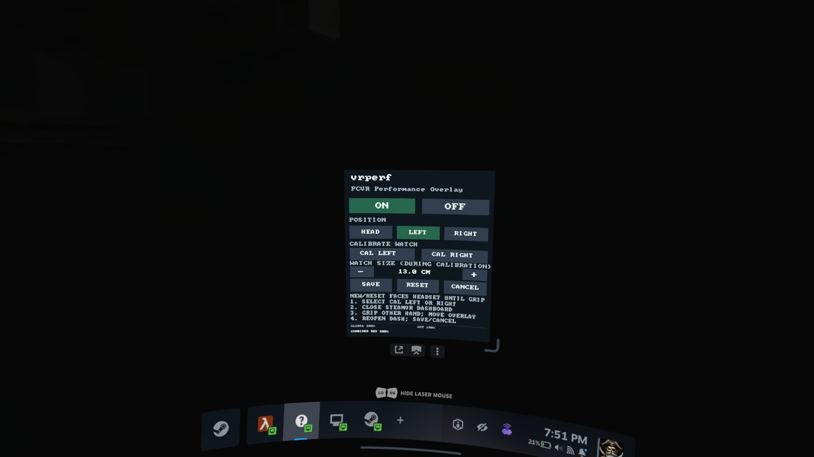

# vrperf

vrperf is a lightweight, native Linux performance overlay for SteamVR, written in Rust. It shows PC frame times, graphs and hardware readings inside your headset. You can place it in front of your view (**HEAD**) or attach it to the **LEFT** or **RIGHT** controller as a watch.

Developed and tested with Arch Linux, SteamVR, Steam Frame and an AMD Radeon RX 9070 XT. Support for other hardware is best effort.

**Source version:** `1.39.0`. Run `vrperf --version` to check the installed binary. Published versions are identified by their Git tags.



## Install

### Download a Linux release

1. Download `vrperf.tar.gz` from the [latest GitHub release](https://github.com/GREYBE4RD/vrperf/releases/latest).
2. Extract it in the download directory:

   ```bash
   tar -xzf vrperf.tar.gz
   ```

3. **Start SteamVR**, then install the extracted executable:

   ```bash
   ./vrperf --install
   ```

4. **Fully restart SteamVR.** vrperf should then start automatically and appear in the SteamVR dashboard.

The installer places the executable at `~/.local/bin/vrperf` and registers vrperf as a SteamVR startup overlay. You do not need Rust or build tools for the prebuilt binary, but you need compatible Linux system libraries.

If the binary is not compatible with your distribution, [build from source](docs/building.md). See [installation and startup troubleshooting](docs/troubleshooting.md#installation-and-startup) if the dashboard tab does not appear.

### Build from source

On Arch Linux, install the build dependencies:

```bash
sudo pacman -S --needed rust base-devel cmake clang libglvnd
```

Then build, test and install:

```bash
git clone https://github.com/GREYBE4RD/vrperf.git && cd vrperf
cargo test --locked && cargo build --release --locked
./target/release/vrperf --install
```

Keep SteamVR running for the install step, then fully restart it. For Ubuntu/Debian dependencies, toolchain requirements and manual testing, see the [build guide](docs/building.md).

## First use

1. Start SteamVR and open its dashboard.
2. Open the **vrperf** tab. Its icon may appear as `?`; hovering over it should show its name.
3. Under **POSITION**, select **HEAD**, **LEFT** or **RIGHT**.
4. Select **ON** or **OFF** to show or hide the overlay. vrperf remembers your selection.



*The dashboard screenshot shows an older layout. In current versions, ON and OFF are separate buttons near the top.*

**HEAD** stays fixed in your view. A saved LEFT or RIGHT watch appears when you turn it towards your eyes and look at it. It hides when you look or turn away.

**A new or reset watch faces the headset automatically** so you can find it. It stays above its controller and follows your view until you grab it to set a position. See [watch calibration and RESET](docs/calibration.md) for the full behaviour.

## Calibrate a watch

You can calibrate in SteamVR Home or during a game. **You must close the SteamVR dashboard to move the watch.**

1. In the vrperf dashboard, select **CAL LEFT** or **CAL RIGHT**.
2. **Close the SteamVR dashboard** with the controller's dashboard button.
3. Release, then hold the **grip on the opposite controller**. Use the right controller to move the left watch, or the left controller to move the right watch.
4. Move and rotate that controller to position the watch. Release the grip to leave it in place. You can grab it again to adjust it.
5. Reopen the dashboard. Use **-** and **+** to adjust watch size if needed, then choose **SAVE**.

**RESET** previews the easy-to-find, headset-facing default without changing the watch size. Select **SAVE** to keep the reset placement or **CANCEL** to restore the previous saved calibration. The other watch is not affected. Settings persist after SteamVR restarts and system reboots.

For RESET details, interrupted calibration, controller bindings and manual recovery, see the [calibration guide](docs/calibration.md).

## Update or uninstall

You do **not** need to uninstall before updating. Saved visibility, mode and watch calibrations are retained.

1. Download or build the newer executable.
2. Start SteamVR and stop any running vrperf instance.
3. Run the **new** executable with `--install`, using the same command as above.
4. Fully restart SteamVR.

If you build from an existing Git checkout, run `git pull --ff-only` before rebuilding. See the [build and update guide](docs/building.md#updating) for details.

To uninstall, stop vrperf, start SteamVR and run:

```bash
~/.local/bin/vrperf --uninstall
```

Uninstalling leaves saved preferences and calibrations in place.

## What the display means

The graph shows **PC-side CPU and GPU frame times** against the headset's frame-time budget. It does not measure video encoding, Wi-Fi transmission or headset decoding delays.

| Display | Meaning |
| --- | --- |
| `FPS`, `CPU ms`, `GPU ms` | Frame rate versus target Hz, and CPU/GPU frame time |
| `DROP`, `RES` | SteamVR dropped frames and combined resolution percentage |
| `BAT H/L/R` | Headset, left-controller and right-controller batteries |
| `CPU`, `GPU` | Utilisation and temperature, where sensors are available |
| `RAM`, `VRA` | Used / total system RAM and video memory |

The watch shows measured FPS beside its target rate, for example `FPS 72/90Hz`, and all three batteries as `BAT H99/L85/R72%`. White text identifies labels, units and fixed totals; green indicates normal measured values. Orange/red marks thresholds, and grey indicates missing values. CPU/GPU graph traces keep their separate colours.

The watch retains a compact **550 × 160** layout. It caps displayed temperatures at **99°** and battery/CPU/GPU percentages at **99%**. Actual values still determine warning colours. Orange temperature warnings start at **80°C** and red at **90°C**. Unsupported sensors display `--°`.

See [display readings, graph colours and warning thresholds](docs/display.md), or [GPU/CPU sensor support and limitations](docs/hardware.md).

## Help and technical documentation

- [Troubleshooting](docs/troubleshooting.md): startup, controller bindings, missing readings and display issues.
- [Advanced options and saved settings](docs/configuration.md): command-line flags, PNG capture and preference files.
- [Developer notes](docs/development.md): source layout, rendering and implementation references.
- [Release notes](RELEASE_NOTES.md): changes by version.

Report problems through [GitHub Issues](https://github.com/GREYBE4RD/vrperf/issues). Include your Linux distribution, SteamVR version, headset, GPU/driver and relevant terminal output.

vrperf is licensed under **GPL-3.0-only**. See [LICENSE](LICENSE). Developed with assistance from OpenAI's ChatGPT.
