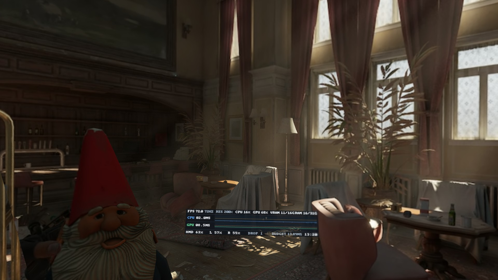
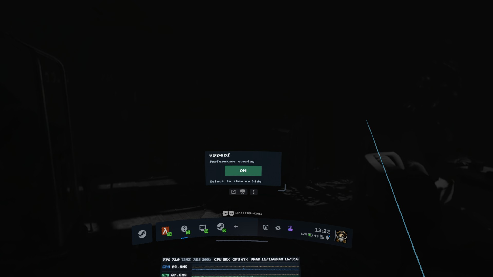

# vrperf

vrperf is a native Linux PCVR performance overlay for SteamVR written in Rust. 

It shows your gaming PC's frame times, performance graphs and hardware statistics inside the headset. It was developed on Arch Linux with a Steam Frame and an AMD Radeon RX 9070 XT.

Choose a panel fixed in front of you (**HEAD**), or a watch attached to your **LEFT** or **RIGHT** controller. Watch positions can be adjusted and saved separately.



## Using vrperf

1. Start SteamVR. If vrperf is installed with automatic startup (default), it should start automatically when SteamVR is started.
2. Open the **SteamVR dashboard** and select the **vrperf** tab (will show as a '?' icon but display vrperf when selected or hovered).
3. Under **POSITION**, select **HEAD**, **LEFT**, or **RIGHT**.
4. Use the separate **ON** and **OFF** buttons at the top to show or hide the panel. vrperf remembers your selection.



*The screenshot shows the earlier dashboard. Since v1.33, ON and OFF are at the top, above the position controls.*

**HEAD** stays fixed in your view. A calibrated **LEFT** or **RIGHT** watch appears when you turn it towards your eyes and look at it. It hides as soon as you turn away, without a fade or delay. Only one display mode is selected at a time.

**On first LEFT/RIGHT use**, the smaller watch uses the original v1.11 controller-relative position and stays visible so you can find it easily. Follow the steps below to place it where you want. Saved positions remain unchanged when you update vrperf.

## Calibrating a watch

In order to move or calibrate the smaller 'watch' performance overlay **You must close the SteamVR dashboard (using the dashboard button on your controller) to move the watch after selected LEFT or RIGHT.** 

Calibration works both while loaded into a game or not. You do not need to exit the game. This enables you to position the display precisely while in game as to not cover anything important.

1. Open the SteamVR dashboard, select the **vrperf** tab, then choose **CAL LEFT** or **CAL RIGHT**.
2. **Close the SteamVR dashboard completely with the Steam dashboard button on your controller.** The watch stays visible while you calibrate it. This should put you back in the game while you calibrate it or simply hide the SteamVR dashboard if you are yet to load into a game.
3. **Hold the grip on the opposite controller.** Use your **right** controller to adjust the **left** watch, or your **left** controller to adjust the **right** watch. The trigger also works with supported bindings.
4. While holding the grip, move and rotate that controller. The watch follows it. Place the watch above your other wrist so you can read it comfortably.
5. Release the grip to leave the watch in place. Hold grip it again to make further adjustments.
6. Reopen the SteamVR dashboard and use the **-** and **+** to change watch size in 0.5 cm steps if needed.
7. Select **SAVE** to keep the position, angle and size. Select **CANCEL** to restore the previous calibration.

Repeat for the other wrist if needed. Releasing the grip **does not save** your changes; reopen the dashboard and select **SAVE**. Selecting another display mode before saving cancels the adjustment. There is no keyboard shortcut for CANCEL; use the dashboard button. If SteamVR exits before SAVE, the last saved position returns when you restart.

Before its first saved calibration, a watch uses the unrotated v1.11 controller offset (**12 cm along controller Y and -13 cm along controller Z**). It remains visible while tracked. After saving, normal angle-based visibility takes effect. Saved calibrations persist after reboot and are not changed by an update.

## Installing vrperf

### Download a ready-built version

Where a Linux binary is available, get it from [GitHub Releases](https://github.com/GREYBE4RD/vrperf/releases). A prebuilt version does not need Rust or other build tools.

Extract the downloaded Linux x86-64 archive, start SteamVR, and run the extracted executable with `--install`. For example, for a v1.24.0 release archive:

```bash
tar -xzf vrperf-v1.24.0-linux-x86_64.tar.gz
./vrperf --install
```

Prebuilt binaries depend on compatible Linux system libraries. If one does not work on your distribution, build it from source instead.

### Build from source

You need Linux x86-64, working SteamVR and OpenGL/EGL drivers, Rust supporting the 2024 edition, a C/C++ compiler, CMake, and Clang/libclang. The first build also downloads Rust dependencies.

On Arch Linux, install the build tools:

```bash
sudo pacman -S --needed rust base-devel cmake clang libglvnd
```

On Ubuntu/Debian, install them with:

```bash
sudo apt install cargo rustc build-essential cmake clang libclang-dev libegl-dev libgl-dev
```

Your distribution's Rust version must support the 2024 edition. If it does not, use a current Rust toolchain from [rustup](https://rustup.rs/).

To build the published source, clone the repository:

```bash
git clone https://github.com/GREYBE4RD/vrperf.git && cd vrperf
```

Build and run the tests:

```bash
cargo build --release && cargo test
```

The executable is now `target/release/vrperf`. With SteamVR running, you can test it manually before installing:

```bash
./target/release/vrperf
```

Stop this test copy before installing to avoid two vrperf instances running at once. Then install:

```bash
./target/release/vrperf --install
```

The installer copies vrperf to `~/.local/bin/vrperf`, installs the SteamVR registration and controller bindings under `~/.local/share/vrperf/`, and enables automatic startup. **Fully restart SteamVR** after installation.

To change automatic startup later, open **SteamVR Settings > Startup / Shutdown > Choose Startup Overlay Apps**. This is separate from vrperf's ON/OFF button.

## Updating vrperf

**You do not need to uninstall the old version.** Your saved mode, ON/OFF state, and left/right watch calibrations remain in place.

1. Download the new release or source archive. If you build from source, compile and test the newer version first.
2. Start SteamVR. Stop the running copy of vrperf, including any copy started automatically.
3. Run **the new executable** with `--install`. For a source build, run:

   ```bash
   ./target/release/vrperf --install
   ```

4. **Fully restart SteamVR.** Check the vrperf tab and your saved watch positions.

The installer replaces the old binary and updates SteamVR's controller binding files. You do not need to recalibrate watches after updating. If you use a Git checkout, run `git pull` before rebuilding; downloaded ZIP folders do not support `git pull`.

To remove vrperf, stop it, start SteamVR, and run:

```bash
~/.local/bin/vrperf --uninstall
```

Uninstalling removes the executable and SteamVR registration but leaves saved preferences and calibrations available for later use.

## Understanding the display

vrperf shows frame times measured **on the gaming PC**, not the time needed to encode, transmit or decode the headset video stream. The HEAD panel is larger; the LEFT and RIGHT panels use a smaller watch layout. The watch uses a compact 550 x 160 pixel panel with top and bottom padding and a 16-pixel-high font. Its on-screen physical width is scaled with the raster width, about 1.8% narrower than v1.31. This keeps the graph and both text rows aligned without cutting off the top line. Both use the same graph colours.

| Graph element | Colour | Meaning |
| --- | --- | --- |
| CPU trace | Blue | CPU frame time within budget |
| CPU trace above budget | Amber / yellow | CPU frame time exceeds budget |
| GPU trace | Green | GPU frame time within budget |
| GPU trace above budget | Orange | GPU frame time exceeds budget |
| Horizontal dashed line | Muted amber | Frame-time budget for the current refresh rate |
| Vertical markers | Red | Dropped frames |

**Only the parts of a trace over budget change colour.** A trace turns back to blue or green as soon as it returns within budget. The change happens where the line crosses the limit, not across an entire spike or history section. The numeric CPU and GPU frame-time readings use the same normal and warning colours.

The frame-time budget is `1000 ÷ headset refresh rate` in milliseconds. At **90 Hz**, the budget is **11.11 ms** per frame. A CPU or GPU value above 11.11 ms exceeds that budget. This is a warning about frame time, not proof that the PC alone caused a dropped frame.

The watch has one information row above the graph and one below. The top row shows FPS rounded up to a whole number, CPU and GPU frame time in milliseconds, dropped frames and resolution. The bottom row shows headset battery (**BAT**), CPU use, system memory (**RAM**), GPU use and video memory (**VRA**) in that order. The clock is at the right end of the top row. It does not show controller batteries, refresh rate or a numeric frame-budget field. The dashed frame-budget line remains in the graph.

Watch memory readings show used/total GiB without a `G` suffix, such as `VRA 14/16` or `RAM 22/32`. Very large values use `T` for TiB. To save space, watch frame times of 100 ms or more use whole milliseconds, and dropped-frame counts of 1,000 or more use K/M/B suffixes. The displayed text widths determine the horizontal gap between each field, keeping both rows evenly spaced and aligned to the graph edges. Fields can shift slightly when a value gains digits. The maximum formatted values still fit within 550 pixels. Frame-time units are shown as lowercase `ms` in both modes. The graph aligns with the full width of the text rows.

**Resource warning colours apply in both HEAD and watch modes:**

| Measurement | Normal | Orange | Red |
| --- | --- | --- | --- |
| CPU or GPU utilisation | Below 85% | 85% to below 95% | 95% or more |
| RAM or video memory use | Below 85% | 85% to below 95% | 95% or more |
| Headset battery, and controller batteries on HEAD | Above 20% | 11–20% remaining | 10% or less remaining |

Memory warnings use unrounded used/total values. Battery warnings apply to low remaining charge. Missing values have no warning colour.

Other values include dropped-frame counts, SteamVR resolution settings and the local time. Some readings are unavailable on some hardware and appear as `--`.

`RES` combines the SteamVR global and per-application resolution multipliers where available. It does **not** show a game's internal render resolution or upscaling setting.

## Compatibility

| Hardware | Status |
| --- | --- |
| Arch Linux, SteamVR, Steam Frame, Radeon RX 9070 XT | Tested setup |
| Other SteamVR headsets and AMD GPUs | Best effort, not yet tested |
| NVIDIA proprietary drivers | Experimental GPU monitoring, not yet tested |
| Intel GPUs | Experimental GPU monitoring, not yet tested |

**Controller calibration:** Steam Frame grip input has been tested. vrperf also includes best-effort SteamVR bindings for Valve Index, Meta/Oculus Touch, HTC Vive, Vive Cosmos, Windows Mixed Reality, and HP Reverb G2 controllers. These other controllers have not been tested with vrperf. Index grip uses its pressure-sensitive grab input. SteamVR may remap other controller types automatically, but this is not guaranteed.

Controller tracking uses SteamVR's normal left and right tracked-controller roles. Grip and trigger use the SteamVR action input system (`IVRInput`). A tracked controller does not necessarily have working calibration buttons until its bindings are assigned.

## Troubleshooting

**The watch does not move during calibration:** Select CAL LEFT or CAL RIGHT, then **close the SteamVR dashboard**. Release and press the **opposite** grip again, then move that controller. Calibration can continue in a running game. If grip and trigger still do nothing, open **SteamVR Settings > Controllers > Manage Controller Bindings**, select vrperf, and check the bindings. Launch vrperf from a terminal to see input diagnostics.

**A saved watch does not appear:** Turn the calibrated face towards your eyes and look at it. A saved watch uses separate show/hide angle thresholds to avoid flicker. It hides if tracking is lost. An uncalibrated watch remains visible while tracked.

**Reset one watch's position:** Stop vrperf, rename `~/.config/vrperf/watch_left` or `~/.config/vrperf/watch_right`, then restart vrperf. The selected watch returns to its first-use position. This does not change the other watch. If you use `XDG_CONFIG_HOME`, find these files in its `vrperf` folder instead.

**An update still shows the old behaviour:** Check that you installed the **new** executable, then fully restarted SteamVR. Avoid running both a manual copy and the installed copy at the same time.

**Some measurements show `--`:** SteamVR or the GPU driver may not supply that reading. If the graphics upload fails, `--upload raw` is a diagnostic option, but its display may flicker.

Report problems on [GitHub Issues](https://github.com/GREYBE4RD/vrperf/issues). Include the Linux distribution, SteamVR version, headset and controller model, GPU driver and relevant terminal messages.

## Advanced options

```text
--mode head|left|right      Select Head or Left/Right watch
--upload gl|raw            OpenGL upload (default) or raw diagnostic mode
--hz auto|NUMBER           Override detected refresh rate
--width METRES             Head overlay width (default 0.415)
--position X,Y,Z           Head-relative position in metres
--interval-ms 100..1000    Statistics update interval (default 200 ms)
--capture-frame PATH       Save one RGBA PNG before SteamVR upload
--install                  Install and register SteamVR autostart
--uninstall                Unregister and uninstall
--version                  Print version
--help                     Show help
```

`--position` and `--width` affect **HEAD** only. Watch position, orientation and size are set through the dashboard. SteamVR may pass an empty startup argument; vrperf ignores it. Old `--opacity`, `--wrist-style` and `--wrist-placement` options were removed in v1.20.

### Display and monitoring details

- The graph puts frame times up to the budget in its lower 65% and times from the budget to twice the budget in the upper 35%. Larger spikes clip at the top; the numeric reading still shows the actual time.
- The compact watch has two text rows with one graph between them. The clock is at the far right of the upper row. The 550 x 160 raster keeps the 16-pixel font height and narrows the physical watch by about 1.8% relative to v1.31. Existing saved watch positions, orientations and width values remain unchanged; the effective watch width is now smaller.
- Each graph covers individual frames, not an averaged line. Red dropped-frame markers appear above both traces.
- Watch visibility uses calibrated face-angle thresholds of 40° to show and 60° to hide, together with gaze-angle thresholds of 55° to show and 70° to hide. This prevents rapid toggling near the edge. There is no fade or wait timer.
- The panel uses straight RGBA with fixed OpenVR opacity of 0.93. The OpenGL texture path is the default; the raw path may flicker.
- SteamVR/OpenVR supplies frame times and device details. AMD hardware use comes from Linux `amdgpu` sysfs; NVIDIA use comes from NVML (`libnvidia-ml.so.1`); Intel use comes from Level Zero Sysman (`libze_loader.so.1`). The vendor libraries are optional. Intel device selection may be inaccurate with multiple Intel GPUs.
- The displayed dropped-frame count is from SteamVR compositor timing. It does not independently measure wireless packet loss. CPU/GPU frame times do not include encoding, network or headset decoding delays.

### Files and source layout

Settings live under `~/.config/vrperf/` by default. `visible` stores the ON/OFF state, `mode` the selected display mode, and `watch_left` and `watch_right` the independent saved watch placements. The installer does not delete these files during upgrades.

```text
src/main.rs           SteamVR event loop and configuration
src/overlay.rs        Head/watch tracking, visibility and calibration movement
src/calibration.rs    Watch transforms, validation and persistence format
src/input.rs          SteamVR grip/trigger action polling
src/dashboard.rs      Dashboard and calibration controls
src/registration.rs   Install/uninstall and SteamVR action bindings
src/render.rs         Panel rendering and graphs
src/gpu_texture.rs    EGL/OpenGL texture upload
src/timing.rs         Frame times, FPS and dropped frames
src/hardware.rs       Host CPU, RAM and GPU monitoring
src/hardware/         Optional NVIDIA/Intel monitoring backends
src/devices.rs        Controller batteries and resolution settings
src/scene.rs          Game detection
src/config.rs         Command-line configuration
src/capture.rs        Diagnostic PNG capture
assets/steamvr/       SteamVR action manifest and controller bindings
```

vrperf is licensed under **GPL-3.0-only**. See [LICENSE](LICENSE). It was developed with assistance from OpenAI's ChatGPT; development and testing have used Arch Linux, SteamVR and Steam Frame.

API references: [OpenVR](https://github.com/ValveSoftware/openvr), [SteamVR action manifests](https://github.com/ValveSoftware/openvr/wiki/Action-manifest), [AMD GPU metrics](https://www.kernel.org/doc/html/latest/gpu/amdgpu/driver-misc.html), [NVIDIA NVML](https://docs.nvidia.com/deploy/nvml-api/latest/index.html), [Intel Level Zero Sysman](https://oneapi-src.github.io/level-zero-spec/).
